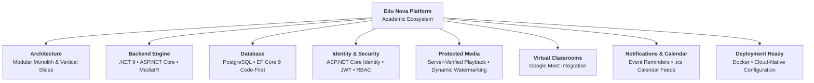
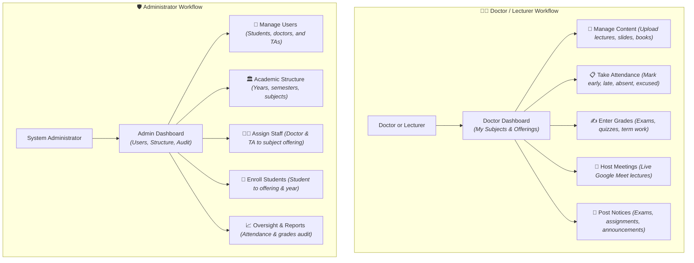
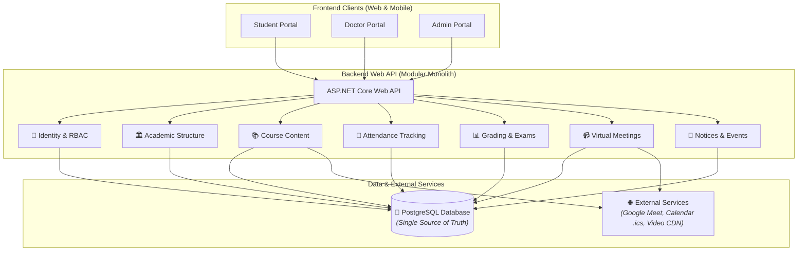
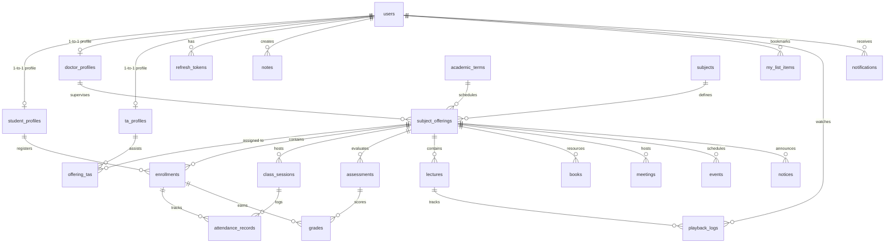
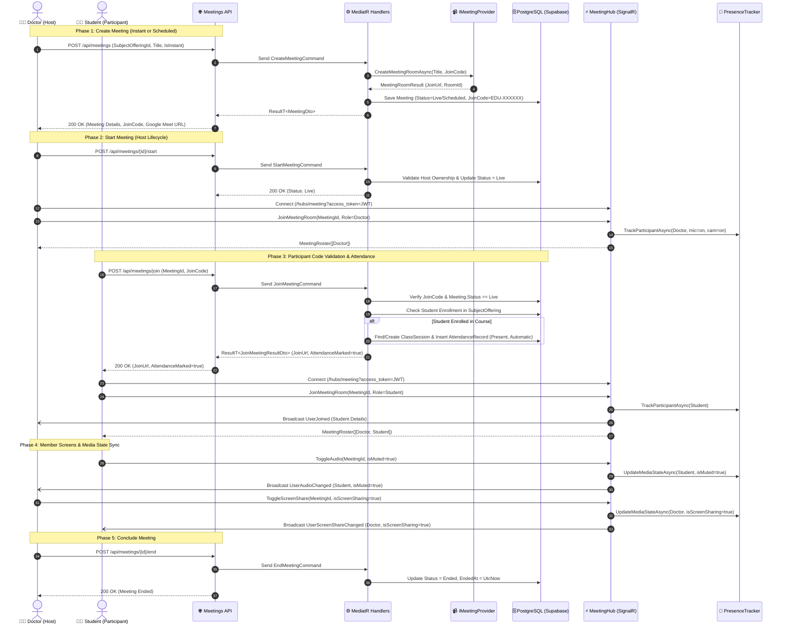

# 🎓 Edu Nova — Learning Platform

> A modern, multi-role academic and learning management platform built with **.NET 9**, **Clean Architecture**, and **PostgreSQL**.



---

## 📌 Table of Contents
1. [Overview & Vision](#-overview--vision)
2. [User Personas & Features](#-user-personas--features)
3. [System Architecture](#-system-architecture)
4. [Database & Domain Architecture](#-database--domain-architecture)
5. [Security & Content Protection](#-security--content-protection)
6. [Project Status & Roadmap Checklist](#-project-status--roadmap-checklist)
7. [Architectural Decision Records (ADR) & Problem Log](#-architectural-decision-records-adr--problem-log)
8. [Team Git Workflow](#-team-git-workflow)
9. [Getting Started & Local Setup](#-getting-started--local-setup)

---

## 🌟 Overview & Vision

**Edu Nova** is designed for higher-education academic workflows, connecting **Students**, **Doctors (Professors)**, **Teaching Assistants (TAs)**, and **Administrators** into a unified educational ecosystem. 

The platform supports digital curriculum delivery, live video lectures, attendance automation, coursework grading, student bookmarks/notes, and administrative oversight.

---

## 👥 User Personas & Features

### 👨‍🎓 1. Student Persona & Flow

```mermaid
flowchart TD
    Student["👨‍🎓 Student"] --> Auth["Sign In / Sign Up<br/><i>(Email, Google, Facebook)</i>"]
    
    Auth --> Home["🏠 Home Tab"]
    Auth --> Meeting["📹 Meeting Tab"]
    Auth --> Profile["👤 Profile Tab"]
    
    Home --> H1["🎥 Lectures <i>(Video Lessons & Tracking)</i>"]
    Home --> H2["📊 Grades <i>(Semester & Cumulative Marks)</i>"]
    Home --> H3["📚 Library <i>(Browse Textbooks & Materials)</i>"]
    Home --> H4["📅 Attendance <i>(Session Status: Early/Late/Absent)</i>"]
    Home --> H5["📝 Notes <i>(Color-coded Personal Notes)</i>"]
    Home --> H6["⏰ Events <i>(Academic Deadlines & Reminders)</i>"]
    Home --> H7["📢 Notices <i>(Course & Campus Updates)</i>"]
    
    Meeting --> M1["➕ Create Meeting <i>(Study Groups)</i>"]
    Meeting --> M2["🔑 Join Meeting <i>(Enter Meeting ID)</i>"]
    Meeting --> M3["🎙️ Live Video Call <i>(Mic & Camera Controls)</i>"]
    
    Profile --> P1["✏️ Edit Profile <i>(Account Details)</i>"]
    Profile --> P2["📥 Downloads <i>(Offline Lectures)</i>"]
    Profile --> P3["⭐ My List <i>(Bookmarked Lectures)</i>"]
    Profile --> P4["⚙️ Settings <i>(Language, Logout)</i>"]
```



---

### 👨‍🏫 2. Doctor & Administrator Workflows



---

## 🏗️ System Architecture

The platform uses a **Modular Monolith** architecture built on **.NET 9 Clean Architecture** with **Vertical Feature Slices**:



### 🧠 Core Architectural Principle
> *"Slices for features, a shared domain core for real business rules, and interfaces only where you talk to external services."*

```
LearningPlatform/
├── LearningPlatform.Domain/          # Enterprise Core: Entities, Enums, Result pattern (Zero external dependencies)
├── LearningPlatform.Application/     # Use Cases: Commands, Queries, MediatR Behaviors, Validators, DTOs
├── LearningPlatform.Infrastructure/  # External Concerns: PostgreSQL DbContext, EF Core Configurations, Identity, Security
└── LearningPlatform.Api/             # Presentation: Web API Controllers, Middlewares, Swagger, DI Composition
```

### 🛠️ Technology Stack

| Component | Technology | Rationale |
| :--- | :--- | :--- |
| **Framework** | **.NET 9 (C# 13)** | High-throughput, cross-platform enterprise runtime |
| **Architecture** | **Clean Architecture + CQRS** | High testability, decoupled business rules, maintainable feature slices |
| **Database** | **PostgreSQL** | Robust relational engine with rich JSONB support for audit logs |
| **ORM** | **EF Core 9 (Npgsql)** | Strongly-typed Code-First migrations with Fluent API configurations |
| **Mediation** | **MediatR** | Decoupled CQRS request handling with open pipeline behaviors |
| **Validation** | **FluentValidation** | Centralized, strongly-typed request validation before handlers execute |
| **Authentication** | **ASP.NET Core Identity + JWT** | Standardized password hashing, refresh tokens, and RBAC |
| **Documentation** | **OpenAPI / Swagger** | Interactive API exploration and client generation |

---

## 🗄️ Database & Domain Architecture

The database schema is organized into **7 Core Domain Modules** with strict referential integrity:



### Module Highlights

1. **Identity & Access Management (RBAC)**:
   * `users` holds core authentication data, credentials, and the `user_type` discriminator.
   * `student_profiles`, `doctor_profiles`, and `ta_profiles` isolate role-specific attributes without polluting `users` with nullable columns.
2. **Academic Structure & Scheduling**:
   * Decoupled static curriculum (`subjects`) from dynamic semester execution (`subject_offerings`).
   * A `subject_offering` links a subject, academic term, supervising doctor, and assigned TAs (`offering_tas`).
3. **Enrollments & Historical Evaluation**:
   * Academic records (`attendance_records`, `grades`) are bound to the **`enrollment` record**, not directly to the student ID. If a student retakes a course in a future term, their past grades and attendance remain historical and accurate.
4. **Content & Live Meetings**:
   * Digital resources (`lectures`, `books`) and scheduled Google Meet sessions (`meetings`).
   * Engagement tracked via `playback_logs` and personal `my_list_items`.
5. **System Auditing & Operations**:
   * `audit_logs` records change snapshots using PostgreSQL `jsonb` fields (`old_values`, `new_values`).

---

## 🔒 Security & Content Protection

* **Secure Playback Verification**: Video streaming identifiers are **never** exposed directly in public pages. The frontend calls `GET /lectures/{id}/playback`, where the backend verifies enrollment and active subscription before returning a time-limited stream/unlisted reference.
* **Audit Trail**: Every video access event logs the student ID, IP, and timestamp into `playback_logs`.
* **Dynamic Player Watermark**: The video player overlays a semi-transparent moving watermark with the logged-in student's name and university email to discourage screen recordings.
* **Secret Protection**: Video assets can be rotated or replaced at the provider level if leaks occur.

---

## 📋 Project Status & Roadmap Checklist

### ✅ Completed
- [x] **Clean Architecture Foundation**: Setup .NET 9 projects (`Api`, `Application`, `Domain`, `Infrastructure`).
- [x] **Domain Entities**: Modeled 25 entities across Identity, Academic, Attendance, Grading, Content, Engagement, and Audit.
- [x] **Entity Type Configurations**: Fluent API mapping configurations for all 25 entities with foreign keys and cascade rules.
- [x] **Shared Result Pattern**: Implemented `Result`, `ResultT<T>`, and `ErrorType` (`NotFound`, `Validation`, `Unauthorized`, `Conflict`, `Failure`).
- [x] **MediatR Pipeline Behaviors**: Open behaviors for `LoggingBehavior` (duration profiling) and `ValidationBehavior` (FluentValidation).
- [x] **Global Error Handling**: Custom `IExceptionHandler` middleware producing RFC 7807 `ValidationProblemDetails`.
- [x] **API Base Controller**: Standardized `AppControllerBase` with `HandleResult` mapping domain results to HTTP responses.
- [x] **Swagger & OpenAPI**: Configured OpenAPI / SwaggerUI support.
- [x] **User Role Optimization**: Added `UserType` enum discriminator to `User` for 0-join authentication lookups.
- [x] **Authentication Feature Slice**:
  - [x] User Registration with password hashing
  - [x] Login with JWT Access Token & Refresh Token issuance
  - [x] Email & SMS OTP generation and verification
  - [x] Password reset & forgot password workflows
  - [x] External OAuth login (Google & Facebook handlers)
  - [x] Database seeder for default roles and admin account
  - [x] Initial EF Core Identity migrations generated

### 🔄 In Progress / Next Up
- [ ] **Database Setup & Verification**: Execute migrations against a local/Docker PostgreSQL instance (`dotnet ef database update`).
- [ ] **Academic Management Slices**:
  - [ ] Academic Terms CRUD (active semester switching)
  - [ ] Subject & Curriculum Management
  - [ ] Subject Offering creation & Doctor/TA assignment
  - [ ] Student Course Enrollment workflow
- [ ] **Attendance Tracking Slices**:
  - [ ] Class session scheduling
  - [ ] Batch attendance recording (Present, Late, Absent, Excused)
  - [ ] Student attendance percentage reports
- [ ] **Learning Content Slices**:
  - [ ] Lecture upload, ordering, and publishing
  - [ ] Textbook / PDF material management
  - [ ] Protected playback URL generation with `PlaybackLog` tracking
- [ ] **Assessment & Grading Slices**:
  - [ ] Assessment creation (exams, quizzes, milestones)
  - [ ] Grade entry & publication
  - [ ] Student term grade calculation
- [x] **Meetings & Realtime Infrastructure**:
  - [x] Choose option: Instant vs. Scheduled meeting creation with Google Meet integration
  - [x] Host/Doctor meeting lifecycle (Start, End, status management)
  - [x] Participant join code validation & automated attendance tracking (`AttendanceRecord`)
  - [x] Meeting member screens: Real-time participant presence, roster, mic/cam/screen share sync via SignalR (`MeetingHub`)
  - [x] In-memory thread-safe presence tracking (`IMeetingPresenceTracker` / `ConcurrentDictionary`)
  - [x] SignalR WebSocket JWT query string authentication handshake
  - [ ] Offering notices & student notification dispatch
- [ ] **Client Applications**:
  - [ ] Student Web Portal
  - [ ] Doctor / Lecturer Portal
  - [ ] Admin Portal

---

## 📝 Architectural Decision Records (ADR) & Problem Log

### 📄 ADR-001: User Modeling Strategy — Composition with Discriminator
* **Date**: October 2026
* **Context**: We needed to model multi-role users (Students, Doctors, TAs, Admins) who share authentication data but have distinct academic fields (`student_code`, `academic_title`, `department`).
* **Options Considered**:
  1. *TPH (Table-Per-Hierarchy)*: Single table with discriminator. ❌ *Rejected: Required role attributes to be nullable; lost DB constraints.*
  2. *TPT (Table-Per-Type)*: C# inheritance with child tables. ❌ *Rejected: EF Core forces automatic `LEFT JOIN`s across all tables on every login query; prevents role evolution.*
  3. *Composition with `UserType` (Chosen)*: Dedicated 1-to-1 profile tables (`student_profiles`, `doctor_profiles`, `ta_profiles`) linked to `users`, with a `UserType` enum discriminator on `users`.
* **Decision**: Adopted **Composition + UserType Discriminator**.
* **Outcome**:
  * 0 SQL joins needed on login/authentication.
  * Strict `NOT NULL` and `UNIQUE` constraints in profile tables.
  * Seamless role transitions (e.g., Student graduating and becoming a TA keeps past grades safe).

### 📄 ADR-002: Historical Integrity via Enrollment-Bound Records
* **Date**: October 2026
* **Context**: If a student fails a course or retakes a class in another term, their grades and attendance records must remain tied to the semester they attended.
* **Decision**: `attendance_records` and `grades` reference `enrollment_id` instead of a direct `student_id + subject_id`.
* **Outcome**: Prevents historical grade overrides and accurately supports course retakes.

### 📄 ADR-003: Video Leak Deterrence & Playback Auditing
* **Date**: October 2026
* **Context**: Preventing unauthorized redistribution of recorded lectures without complex and expensive DRM infrastructure.
* **Decision**:
  1. No raw video IDs exposed in the frontend.
  2. Playback requests logged into `playback_logs`.
  3. Dynamic moving watermark containing student credentials over the video player.
* **Outcome**: Lightweight, cost-effective deterrent against illicit screen captures.

### 📄 ADR-004: Live Video Meetings Infrastructure — Google Meet via Calendar API
* **Date**: October 2026
* **Context**: Edu Nova requires live interactive video lectures for university courses ranging from 30 to 100+ students, supporting screen sharing, chat, microphone controls, and automated attendance tracking. We evaluated whether to host our own WebRTC media servers, use public open-source instances (Jitsi), or integrate a cloud provider API.
* **Options Considered**:
  1. *Public Jitsi Meet (`meet.jit.si`)*: ❌ *Rejected*.
     * **Host Authentication Block**: Since August 2023, 8x8 ended anonymous room creation; hosts must authenticate via Google/GitHub in a third-party popup before a room unlocks.
     * **No Backend Control**: The free public `meet.jit.si` exposes no backend REST API to programmatically set room passwords from C#.
     * **Bandwidth & Capacity Throttling**: Public community bridge servers actively throttle bitrates, drop frame rates, or disconnect users once a room exceeds 30–50 participants.
     * **Privacy Vulnerability**: Any unauthenticated stranger who guesses the room URL can enter unless a doctor manually sets a password inside the Jitsi UI.
  2. *Self-Hosted WebRTC / Jitsi on Dedicated Servers (Docker / Kurento / LiveKit)*: ❌ *Rejected*.
     * Requires provisioning high-spec dedicated media servers (heavy CPU for video transcoding and multi-gigabit outbound bandwidth).
     * High operational maintenance and server infrastructure costs for an MVP platform.
  3. *Google Meet via Google Calendar API & OAuth 2.0 (Chosen)*: ✅ *Adopted*.
     * **Enterprise Capacity & Reliability**: Handles 100 to 250+ students with HD video, noise cancellation, and screen sharing across Google's global edge network at zero video server cost to Edu Nova.
     * **Programmatic Room Generation**: Backend calls Google Calendar API (`conferenceDataVersion=1`) to automatically generate authentic `meet.google.com/xxx-yyyy-zzz` links.
     * **Security & Waiting Room**: Built-in "Knock to Enter" / domain restrictions prevent uninvited intruders.
     * **Zero Video Infrastructure Burden**: Edu Nova manages what matters (enrollment verification, automated attendance logging upon clicking "Join", and in-app SignalR member rosters), while Google handles heavy media streaming.
* **Decision**: Adopted **Google Meet via `IMeetingProvider`** abstraction (supporting manual/mock links for local development and Google Calendar API for production).
* **Outcome**: High-performance, zero-cost video streaming infrastructure supporting 100+ students per lecture with seamless attendance tracking.

### 📄 ADR-005: Hybrid Realtime Meeting Orchestration & Presence Architecture
* **Date**: October 2026
* **Context**: Edu Nova requires an integrated virtual classroom experience where professors can host lectures, control meeting lifecycles, and monitor live attendance, while participants can enter with participant codes, view real-time member rosters, and toggle microphone, camera, and screen sharing states.
* **Architectural Strategy (Hybrid Split-Plane Model)**:
  * **Media Plane (Google Meet)**: High-bandwidth audio, HD video feeds, noise filtering, and screen video transmission are delegated to Google’s edge infrastructure via [`IMeetingProvider`](file:///D:/ACCS2/IAProject/codePlus_LearingPlatform/LearningPlatform/LearningPlatform.Application/Common/Interfaces/IMeetingProvider.cs).
  * **Control & Presence Plane (Edu Nova SignalR Hub)**: In-app participant rosters, connection state, participant code verification, mute/camera/screen-share badges, in-meeting chat, and automated attendance tracking are orchestrated within Edu Nova's ASP.NET Core backend.
* **Decision**: 
  1. Implemented **Dual-Entry Lifecycle**: Hosts (Doctors) can start and enter meetings unconditionally; Students/participants require a valid participant join code (`EDU-XXXXXX`), and the meeting must be `Live`.
  2. Built in-memory thread-safe presence tracking via [`IMeetingPresenceTracker`](file:///D:/ACCS2/IAProject/codePlus_LearingPlatform/LearningPlatform/LearningPlatform.Application/Common/Interfaces/IMeetingPresenceTracker.cs) backed by `ConcurrentDictionary` for $O(1)$ real-time lookup without database polling.
  3. Linked participant admission directly to automated attendance: Enrolled students entering an active lecture automatically generate/update [`AttendanceRecord`](file:///D:/ACCS2/IAProject/codePlus_LearingPlatform/LearningPlatform/LearningPlatform.Domain/Entities/Attendance/AttendanceRecord.cs) (`Status = Present`, `Source = Automatic`).
* **Outcome**: Scalable, zero-video-server-cost architecture delivering high-fidelity lecture streaming combined with complete academic attendance governance.

---

### 🔄 Realtime Meeting Lifecycle & Presence Sequence Diagram



---

### 🛠️ Realtime Implementation Problems & Solutions Log

During the implementation of the **Realtime Meetings & Infrastructure** module, we encountered several architectural, runtime, and integration hurdles. The following log documents each challenge, the root cause analysis, and the applied engineering solution:

| # | Challenge / Obstacle | Root Cause | Engineering Solution |
| :---: | :--- | :--- | :--- |
| **1** | **Public Jitsi Meet (`meet.jit.si`) Limitations** | In August 2023, 8x8 ended anonymous room creation, enforcing third-party OAuth logins, bandwidth throttling for rooms > 30 users, and zero backend password management. | Pivoted to **Google Meet via `IMeetingProvider`**. Carrier-grade media streaming (up to 250 students) is offloaded to Google's edge, while Edu Nova governs attendance, join codes, and SignalR presence. |
| **2** | **Third-Party Cloud Credentials Blocking Local Dev** | Google Calendar API requires Google Cloud Console project creation, OAuth consent screens, and client secrets, which would stall developers working offline. | Applied **Dependency Inversion (Strategy Pattern)**: Created `GoogleMeetMeetingProvider` (offline deterministic room generator) for development, which can be swapped with `GoogleCalendarMeetProvider` via a single line in `DependencyInjection.cs`. |
| **3** | **`500 Internal Server Error` on Login (`column "UserType" does not exist`)** | `UserType` discriminator was added to the `User` domain entity, but no corresponding EF Core migration had been generated or applied to the shared PostgreSQL database. | Generated migration `20261013190541_AddUserTypeToUser` and applied it to Supabase via `dotnet ef database update`, synchronizing the physical schema. |
| **4** | **Host Runtime Mismatch (`.NET 10` Host vs `.NET 9` Project)** | The development machine had .NET 10 SDK/runtime installed (`10.0.10`), while the project targets `net9.0`. By default, .NET disallows major version roll-forwards. | Added `<RollForward>LatestMajor</RollForward>` to [`LearningPlatform.Api.csproj`](file:///D:/ACCS2/IAProject/codePlus_LearingPlatform/LearningPlatform/LearningPlatform.Api/LearningPlatform.Api.csproj#L7), allowing .NET 10 to host the .NET 9 app without downloading additional runtimes. |
| **5** | **Swagger UI "Failed to Fetch / CORS" on HTTP Localhost** | `app.UseHttpsRedirection()` forced HTTP requests (`http://localhost:5114`) to redirect to HTTPS, causing browser `fetch` calls with authorization headers to fail security policies. | Conditioned HTTPS redirection in [`Program.cs`](file:///D:/ACCS2/IAProject/codePlus_LearingPlatform/LearningPlatform/LearningPlatform.Api/Program.cs#L106-L109) to non-development environments (`if (!app.Environment.IsDevelopment())`), enabling smooth local Swagger testing on HTTP. |
| **6** | **`404 Subject offering not found` on Meeting Creation** | Foreign key constraint required a valid `SubjectOfferingId`, but the shared database had no academic courses or terms seeded yet. | Extended [`DatabaseSeeder.cs`](file:///D:/ACCS2/IAProject/codePlus_LearingPlatform/LearningPlatform/LearningPlatform.Infrastructure/Data/DatabaseSeeder.cs) with `SeedSampleAcademicDataAsync` to seed a deterministic test course (`CS101` with ID `11111111-1111-1111-1111-111111111111`), academic term, and doctor profile on startup. |
| **7** | **SignalR WebSocket JWT Authentication Handshake** | WebSockets cannot send standard `Authorization: Bearer <token>` HTTP headers during the initial browser connection handshake. | Configured `JwtBearerEvents.OnMessageReceived` in [`Program.cs`](file:///D:/ACCS2/IAProject/codePlus_LearingPlatform/LearningPlatform/LearningPlatform.Api/Program.cs#L51-L64) to extract `access_token` from query parameters specifically for `/hubs/*` routes. |

---

## 🤝 Team Git Workflow

To maintain build stability with all members holding repository ownership:

1. **Golden Rule**: **Never push directly to `main`.** All code merges via Pull Requests (PRs).
2. **Branch Naming**:
   * `feature/<issue-number>-<feature-name>` (e.g., `feature/140-attendance-api`)
   * `fix/<issue-number>-<bug-name>`
   * `chore/<task-name>`
3. **Daily Routine**:
   ```bash
   # 1. Update your local main
   git checkout main
   git pull origin main

   # 2. Create your task branch
   git checkout -b feature/your-task-name

   # 3. Work, test, and commit with meaningful messages
   git add .
   git commit -m "feat(module): descriptive summary of changes"

   # 4. Sync main before pushing (resolve any conflicts locally!)
   git checkout main
   git pull origin main
   git checkout feature/your-task-name
   git merge main

   # 5. Push and open PR
   git push -u origin feature/your-task-name
   ```
4. **Commit Standard**: Use Conventional Commits (`feat:`, `fix:`, `refactor:`, `docs:`, `chore:`). Include a Problem/Solution body for architectural changes.

---

## 🚀 Getting Started & Local Setup

### Prerequisites
* [.NET 9 SDK](https://dotnet.microsoft.com/download/dotnet/9.0) (or .NET 10 with backward compatibility)
* [PostgreSQL](https://www.postgresql.org/) (Local instance or Docker container)
* Visual Studio 2022 / JetBrains Rider / VS Code

### 1. Clone the repository
```bash
git clone git@github.com:LearningPlatform-Team/LearningPlatform.git
cd LearningPlatform
```

### 2. Configure Database Connection
Update the connection string in [`LearningPlatform.Api/appsettings.json`](file:///D:/ACCS2/IAProject/codePlus_LearingPlatform/LearningPlatform/LearningPlatform.Api/appsettings.json):
```json
"ConnectionStrings": {
  "DefaultConnection": "Host=localhost;Port=5432;Database=LearningPlatformDb;Username=postgres;Password=your_password"
}
```

### 3. Apply Migrations & Seed Data
```bash
dotnet ef database update --project LearningPlatform.Infrastructure --startup-project LearningPlatform.Api
```

### 4. Run the API
```bash
dotnet run --project LearningPlatform.Api
```
Navigate to `https://localhost:7000/swagger` to explore the interactive API documentation.
